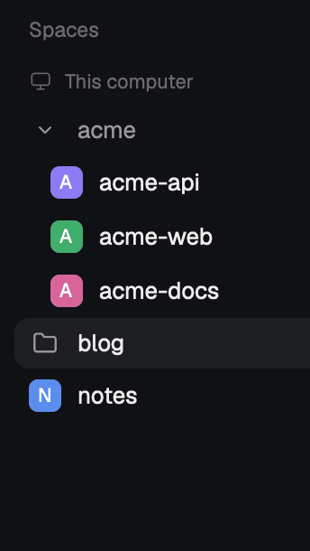

# herdr-space-groups

Foldable groups in the Herdr app's Spaces sidebar. `globex-shop`, `globex-app`
and `globex-billing` go under one **globex** header. Click the header to fold it.



- **Automatic groups:** spaces whose names share a prefix before `-`, `_` or
  `.` form a group when there are 2 or more of them.
- **Your own groups:** list them in `groups.json` (see below). They win over
  automatic groups.
- A group appears where its first space was. Worktrees stay under their repo.
- A folded group shows a folder icon, how many spaces it holds, a dot when an
  agent in it is blocked or done, and the space you are in.
- Machine headers, worktree nesting, drag to reorder and the space menu work
  as in Herdr's own sidebar.

The mod is a copy of Herdr's shipped `spaces` mod (0.1.12) with the group
code added. Each change is marked `groups:` in `main.js`; the logic is in
`groups.js`. When Herdr updates its `spaces` mod, merge the update by hand.

## Install

    git clone https://github.com/ashrodan/herdr-space-groups && cd herdr-space-groups

    ./scripts/install.sh                       # copy into ~/.config/herdr-app/mods
    ./scripts/install.sh --layout my-layout    # and use it in place of `spaces`
    ./scripts/install.sh --undo --layout my-layout   # put `spaces` back

The script backs up the layout once to `<name>.json.before-spaces-groups`.
It refuses Herdr's own layouts (`main`, `terminals`, `win98`): Herdr replaces
them on every start. Clone one first: `herdr-app do layout.clone --name main --as my-main`.

For an agent: "Read ~/.config/herdr-app/AGENTS.md, then install this mod:
https://github.com/ashrodan/herdr-space-groups".

What it runs: the same as Herdr's sidebar (`git` per space, on its machine,
and `hc machine ls`). No network access of its own. It reads only its own
`groups.json` beyond that.

## groups.json

`~/.config/herdr-app/mods/spaces-groups/groups.json`. Install makes it from
`groups.example.json` once and never overwrites it. Saving it reloads the mod.

```json
{
  "auto": true,
  "min": 2,
  "separators": "-_.",
  "groups": { "globex": ["globex-*"], "clients": ["acme-api", "web"] },
  "ignore": ["~"]
}
```

A pattern is a space name, `*` matches anything, case does not matter. An
error in the file shows in red at the bottom of the list.

## Commands

| Command | Does |
| --- | --- |
| `spaces-groups.fold_all` | fold every group |
| `spaces-groups.unfold_all` | open every group |
| `spaces-groups.toggle` | fold or open the group of the space you are in |

Bind them in `keys.json`, or run `herdr-app do spaces-groups.toggle`.
Fold state is kept per window copy (`localStorage`).

## License

MIT for the code written here. Most of `main.js` is Herdr's shipped `spaces`
mod; that part stays under Herdr's terms. See [LICENSE](LICENSE).

## Test

    npm test                                          # groups.js
    herdr-app check ~/.config/herdr-app/mods/spaces-groups
