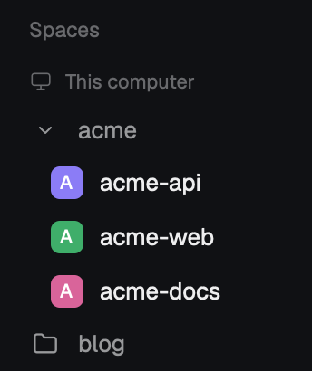

# Space groups

Herdr's Spaces sidebar with foldable groups. Spaces whose names share a
prefix (`acme-api`, `acme-web`, `acme-docs`) sit under one header (`acme`);
a click on the header folds the group to one line.

## What you see

- The Spaces sidebar as Herdr ships it: "Spaces" title with `+`, a header per
  machine once a remote machine is known, colored letter avatars, repo and
  branch after each name, worktrees under their repo with a branch icon.
- A group header row, 28px high, 8px padding, 9px gap, rounded 8: an 18px
  slot with a 12px `chevron-down.svg` (open) or a 14px `folder.svg` (folded),
  the group label in `muted` (`foreground` on hover, `hover` background), and
  the number of spaces in it at 11.5px in `dim` on the right.
- Open group: its spaces below the header, indented 12px, each drawn exactly
  like an ungrouped row. Worktree rows stay under their repo inside the group.
- Folded group: the header only, plus the space you are in if it is a member
  (the header then has the `selected` background).
- A bad `groups.json`: its error in `blocked` color, 11px, at the end of the list.

## How it behaves

- Automatic groups: the text before the first `-`, `_` or `.` (with text on
  both sides) is a space's prefix. 2 or more top-level spaces on one machine
  with the same prefix (case ignored) form a group named by the first one's prefix.
- `groups.json` in the mod folder: `auto`, `min`, `separators`,
  `groups: {label: [patterns]}`, `ignore: [patterns]` (default `["~"]`).
  A pattern is a name with `*` for any text. Explicit groups win; a group
  listed there keeps even a single member. Saving the file reloads the mod.
- A group takes the place of its first member; members keep their order.
- Agent status: a folded group shows `●` in the `blocked` or `done` color
  when its most urgent space status (blocked > done > working > idle) is one
  of those. Working and idle show nothing, as in the shipped sidebar.
- Click a header: fold or open it. Fold state is kept in `localStorage`
  (`groups.folded`, keys `<machine>/<label>`, `""` for this computer).
- Commands: `spaces-groups.fold_all`, `spaces-groups.unfold_all`,
  `spaces-groups.toggle` (the group of the space in front, worked out when
  the command runs).
- Narrow sidebar (the compact rail, under 160px): no groups, the shipped rail.
- Everything else (click to switch, right-click menu, drag to reorder within
  a machine, machine fold and reconnect) is the shipped `spaces` mod's.

## Built from

- `mods/spaces-groups/main.js`: Herdr's shipped `spaces` mod (0.1.12), with
  changes marked `groups:` — imports `readTextFile`, `appHome`, `nextCommand`;
  `init` reads `groups.json` once and starts the command loop; `grouped()`
  draws each machine's rows through `withGroups(rows, machine, t, collapsed, draw)`;
  `command`, `groupOfActive`, `toggleGroup`.
- `mods/spaces-groups/groups.js`: pure functions, no `herdr` import —
  `config`, `matches`, `prefix`, `assign`, `layout`, `urgent`.
- Layout: the sidebar block's `content.mod` changes from `spaces` to
  `spaces-groups` (`scripts/install.sh --layout NAME`).
- Art: `mods/workspace-chrome/{chevron-down,folder}.svg` (shipped).
- Runs the same programs as the shipped sidebar: `git` (per space, on its
  machine) and `hc machine ls`. No network of its own. Reads only its own
  `groups.json` beyond what the shipped mod reads.

## Watch out

- Herdr writes `gpui-kit.d.ts` and `jsconfig.json` into the mod folder; don't commit them.
- Do group work on rows after `ordered()`, so worktree rows (with `tree`) move
  with their main row. Grouping before nesting splits worktrees from repos.
- Don't keep "which group is active" from the last render for commands: a
  command can arrive before the next render. Work it out from `spaces()` then.
- Herdr replaces its own layouts (`main`, `terminals`, `win98`) on start.
  Install into a cloned layout.
- Updates to Herdr's `spaces` mod don't reach this copy; merge them by hand.

## Done when

- `npm test` passes (prefix, patterns, assign, layout with worktrees, config errors, urgent).
- `herdr-app check mods/spaces-groups` passes; `herdr-app status` shows no errors.
- With spaces `acme-api`, `acme-web`, `acme-docs`, `blog-site`, `blog-drafts`:
  headers `acme` (3) and `blog` (2) appear where `acme-api` and `blog-site` were.
- A click on `blog` folds it to one line with a folder icon; the space you are
  in stays visible under a folded header.
- `herdr-app do spaces-groups.toggle` in a grouped space folds its group; again opens it.
- `"auto": false` in `groups.json` removes automatic groups; `"groups": {"x": ["acme-api"]}`
  makes a one-space group `x`; invalid JSON shows its error in red.
- A worktree space stays under its repo inside the group.
